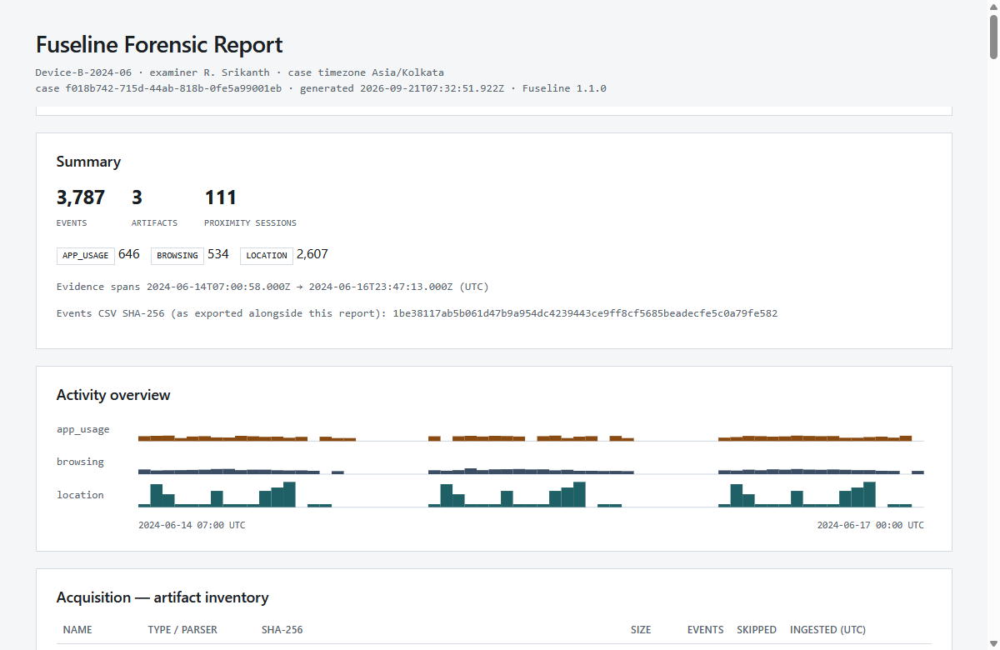

# Fuseline

Correlate location data, browsing history, and app usage into one UTC timeline. Where those sources fall close together, Fuseline draws a proximity session and keeps the hash of every file that produced it.

Workflow: **Acquisition → Analysis → Validation → Report**

| | Development | Single process / Docker |
|---|---|---|
| UI | http://127.0.0.1:5173 | http://127.0.0.1:8000 |
| API | http://127.0.0.1:8000 | http://127.0.0.1:8000 |
| OpenAPI | http://127.0.0.1:8000/docs | http://127.0.0.1:8000/docs |

## Contents

1. [Application](#application)
2. [Problem](#problem)
3. [Run](#run)
4. [Workflow](#workflow)
5. [Evidence formats](#evidence-formats)
6. [How correlation works](#how-correlation-works)
7. [API](#api)
8. [Configuration](#configuration)
9. [Security](#security)
10. [Repository](#repository)
11. [Project report](#project-report)
12. [Development](#development)
13. [License](#license)

## Application


Timeline zoomed to one proximity session. The selected fix shows its original timestamp, time basis, artifact, and hash.


The same case zoomed out. When the window holds too many events to draw one by one, the lanes switch to density.



The HTML report written from a case: counts, source totals, and the activity overview. CSV and JSON exports are separate.

**Acquisition.** A case stores the examiner, the device timezone, and its own SQLite file. Files are recognised by content. Each file is hashed with SHA-256, stored read-only, and checked again on verify. Rows that cannot be parsed are skipped and counted.

**Analysis.** Location, browsing, and app usage sit on separate lanes. A session is a band across the lanes it contains. The location plot is drawn locally. Every event records whether its UTC time was absolute, offset, or assumed.

**Validation and report.** Findings cover coverage, skipped rows, assumed time, gaps, sources that do not overlap, and dates outside the expected range. The HTML report is self-contained. The audit log is append-only and hash-chained, and the HTML report includes that chain.

The interface has light, dark, and auto themes. Chart fonts are bundled with the app.

## Problem

Correlate location data, browsing history, and app usage logs into a unified forensic timeline.

| | |
|---|---|
| Objective | A chronological view of Android activity across those sources |
| Stack | Python, SQLite, optional Plaso import |
| Approach | Extract timestamps, normalise to UTC, correlate events, present one timeline |
| Output | One timeline, proximity sessions, and a case report |

## Run

```bash
git clone https://github.com/navneetxdd/fuseline.git
cd fuseline
```

Python 3.11 or newer. Node.js 22.12 or newer for the test runner. Node.js 20.19 is enough to run and build the UI.

**Windows**

```powershell
.\scripts\run_dev.ps1
```

**Linux / macOS**

```bash
bash scripts/run_dev.sh
```

The script creates `.venv`, installs dependencies, installs the UI, and starts both servers. Open http://127.0.0.1:5173. If that port is busy, Vite takes the next one. Fuseline accepts any loopback origin.

<details>
<summary>Manual setup</summary>

```powershell
python -m venv .venv
.\.venv\Scripts\pip install -r requirements-dev.txt
cd frontend
npm install
cd ..
.\.venv\Scripts\python -m uvicorn app.main:app --reload --app-dir backend
cd frontend
npm run dev
```

</details>

**Single process.** The UI is built once and served by FastAPI.

```powershell
.\scripts\run_prod.ps1
```

```bash
bash scripts/run_prod.sh
```

On Windows, `-Port 9000` changes the port and `-Rebuild` forces a UI rebuild. On Linux and macOS, pass the port as an argument and set `REBUILD=1` to rebuild the UI.

**Docker**

```bash
docker compose up --build
```

The UI and API are both at http://127.0.0.1:8000. Case files stay in the `fuseline-data` volume. The compose file publishes the port on loopback only. See [Security](#security).

## Workflow

1. **Cases.** Enter a case name, the examiner, and the device timezone. The timezone is used only for timestamps that carry no zone. Choose *Create & acquire*.
2. **Acquire.** Drop evidence files, or choose *Detect device* on an Android phone with USB debugging authorised. *Acquire all available* pulls `dumpsys usagestats`, a `dumpsys location` snapshot when that text has timed coordinates, and supported files under Download and Documents, including a nested Takeout folder. Project-local `adb` is installed under `tools/platform-tools/` by `scripts/ensure_platform_tools.py` and by `run_dev`. *Verify integrity* re-hashes every stored copy and checks the audit chain.
3. **Timeline.** Scroll to zoom and drag to pan, or drag the overview window. Select a mark, a table row, or a map point to inspect it. Select a proximity session to zoom to it. *Correlation* changes the window, the minimum number of sources, and the maximum session length.
4. **Report.** Read the findings, the sessions, and the chain of custody. Export HTML, CSV, or JSON.

## Evidence formats

The parser is chosen from the file content: SQLite schema, CSV header, or XML/JSON structure. The source hint on Acquire only narrows which parsers are tried.

| Source | Accepted input |
|---|---|
| Browsing | Chromium, Chrome, or Edge `History` (visits, transition types, search terms, downloads). Firefox or Firefox for Android `places.sqlite`. |
| App usage | Android UsageStats SQLite (`events` and `packages`), ALEAPP-style CSV, UsageStats XML, and `adb dumpsys usagestats` text. Event numbers follow the Android `UsageEvents` constants. |
| Location | CSV or SQLite with latitude, longitude, and time. GPX. Google Takeout `Records.json`. `adb dumpsys location` text when the dump contains timed fixes. |
| Plaso (optional) | `psort` L2TCSV or JSON lines. The timezone on each row is kept. Rows are mapped onto the lanes above. |

Plaso is not required. To import a Plaso timeline:

```bash
log2timeline.py --storage-file evidence.plaso /path/to/extraction
psort.py -o l2tcsv -w timeline.l2t.csv evidence.plaso
```

`psort.py -o json_line` works as well. Upload the result on Acquire.

## How correlation works

```
Acquire → hash → detect format → parse (skips counted) → normalise to UTC → SQLite events
                                                       → validation findings
                                                       → proximity sessions
UI / report exports ← FastAPI
```

### Time

Every event stores the UTC time used for sorting, the original source value, and a basis.

| Basis | Meaning |
|---|---|
| `absolute` | The source was an epoch number, or a string already marked as UTC. |
| `offset` | The source carried an explicit offset, such as `-05:00`, and was converted. |
| `assumed` | The source had no zone. It was read in the case timezone and flagged (`TZ_ASSUMED`). |

### Proximity sessions

Events are sorted by UTC time, then by event id. An event joins the current cluster when it is within the window of the previous event. The default window is 300 seconds. A cluster is kept when it contains at least two distinct sources. A cluster longer than 30 minutes is split at its widest gap. Each event is in at most one session. The same bytes and the same settings produce the same sessions.

The score used to rank sessions is the number of distinct sources, plus 0.5 if a location source is present, plus the smaller of 1 and (event count / 10).

A session id is a UUID version 5 of its member event ids, in order. An event id is a UUID version 5 of the artifact SHA-256 and the row index inside that artifact.

If the cluster has coordinates, the session stores their centroid and the radius of those points about the centroid. The radius is the spread of the points in that session.

### Integrity

Uploads are hashed, copied, hashed again, and the copy is made read-only. The audit log stores the hash of the previous entry on each new entry. *Verify integrity* recomputes that chain and re-hashes the stored evidence.

## API

Interactive reference: http://127.0.0.1:8000/docs

| Method | Path | Purpose |
|---|---|---|
| GET | `/api/health`, `/api/meta` | Liveness, version, upload limit, supported formats |
| GET, POST | `/api/cases` | List or create cases |
| GET, PATCH, DELETE | `/api/cases/{id}` | Read, edit, or delete a case |
| POST | `/api/cases/{id}/acquire` | Upload an artifact (`file`, optional `source_hint`) |
| GET | `/api/cases/{id}/artifacts` | Artifact inventory |
| POST | `/api/cases/{id}/verify` | Re-hash stored evidence and verify the audit chain |
| GET | `/api/cases/{id}/audit` | Chain-of-custody entries |
| GET | `/api/cases/{id}/timeline` | Events. Query: `source`, `q`, `start`, `end`, `offset`, `limit`, `order`. `total` and `has_more` are always returned |
| GET | `/api/cases/{id}/events/{event_id}` | One event |
| GET | `/api/cases/{id}/overview` | Per-source counts in time buckets |
| GET | `/api/cases/{id}/locations` | Location fixes, down-sampled for drawing |
| GET | `/api/cases/{id}/sessions` | Proximity sessions |
| GET | `/api/cases/{id}/sessions/params` | Correlation parameters in effect |
| POST | `/api/cases/{id}/sessions/rebuild` | Rebuild with `window_seconds`, `max_span_seconds`, `min_sources` |
| GET | `/api/cases/{id}/sessions/{session_id}/events` | Events in one session |
| GET | `/api/cases/{id}/validation` | Validation findings. `?refresh=true` recomputes them |
| GET | `/api/cases/{id}/report` | Report summary (JSON) |
| GET | `/api/cases/{id}/report/html` | Self-contained HTML report |
| GET | `/api/cases/{id}/report/csv` | CSV. `?raw=true` turns off formula neutralisation |
| GET | `/api/cases/{id}/report/json` | JSON export, including the audit trail |
| GET | `/api/devices` | USB-attached Android devices |
| GET | `/api/devices/{serial}/exports` | Supported files on shared storage |
| POST | `/api/cases/{id}/acquire/device/{serial}/app-usage` | Pull and ingest `dumpsys usagestats` |
| POST | `/api/cases/{id}/acquire/device/{serial}/location` | Pull and ingest `dumpsys location` |
| POST | `/api/cases/{id}/acquire/device/{serial}/export` | Pull one file. Body: `{ "remote_path": "..." }` |
| POST | `/api/cases/{id}/acquire/device/{serial}/bundle` | Pull usage, location, and the listed exports |

## Configuration

| Variable | Default | Purpose |
|---|---|---|
| `FUSELINE_DATA_DIR` | `./data` | Case databases, evidence copies, and the audit log |
| `FUSELINE_MAX_UPLOAD_MB` | `64` | Per-file upload limit |
| `FUSELINE_ADB` | auto | Absolute path to `adb`, if you do not want `tools/platform-tools/` |
| `FUSELINE_ALLOWED_HOSTS` | `127.0.0.1,localhost,[::1]` | `Host` values the API answers. `*` disables the check |
| `FUSELINE_ALLOWED_ORIGINS` | empty | Extra browser origins allowed to change state |
| `FUSELINE_ALLOW_LOOPBACK_ORIGINS` | `1` | Trust any loopback origin, such as the Vite dev server. `0` restricts the API to same-origin plus the list above |
| `FUSELINE_API` | `http://127.0.0.1:8000` | API target of the Vite dev proxy |

## Security

Fuseline is a local examiner workstation. It has no login. Anything that can reach the port can read and delete cases, so the port stays on loopback.

- The API checks the `Host` header, and it checks `Origin` on requests that change state. CORS is not a wildcard and does not allow credentials.
- Evidence strings in the HTML report are escaped. The response sends `Content-Security-Policy: default-src 'none'`.
- CSV cells that would run as spreadsheet formulas are prefixed. The JSON export keeps the original text.
- The UI shows evidence URLs defanged, with a Copy button, and strips control and bidirectional-override characters from titles.
- SQLite evidence is opened read-only and `immutable`, with a query time budget. XML is parsed with `defusedxml`. Uploads are size-capped, file names are sanitised, and paths stay under the data directory.
- API responses send `nosniff`, `no-referrer`, `X-Frame-Options: DENY`, and `Cache-Control: no-store`.

## Repository

```
backend/app/     API, parsers, pipeline, report templates
backend/tests/   pytest suite and packed fixtures
frontend/src/    React UI
scripts/         run_dev, run_prod, ensure_platform_tools.py, build_project_report.py
docs/            Project report and screenshots
data/            Runtime case files (gitignored)
```

## Project report

```bash
python scripts/build_project_report.py
```

That writes `docs/Fuseline-Capstone-Report.pdf`. It is the capstone write-up. It is separate from the HTML, CSV, and JSON export of a case.

## Development

```bash
pip install -r requirements-dev.txt
pytest -q
ruff check backend scripts
ruff format --check backend scripts
mypy
```

```bash
cd frontend
npm run lint
npm run typecheck
npm test
npm run build
```

CI (`.github/workflows/ci.yml`) runs the same checks on Python 3.11–3.13 and Node 22, and smoke-tests the Docker image.

Parser layouts follow the public Android, Plaso, and ALEAPP references cited in the project report. No third-party forensic engine is shipped in this repository.

## License

MIT. See [LICENSE](LICENSE).
